# Design System — Aatlas Replay

14/10/2026 · Antonio · versão online: https://claude.ai/code/artifact/3ea7b49e-cadc-4f0f-be38-2c159d10c72c

## Visão geral

O site do Aatlas Replay usa um tema único claro (off-white quente + laranja #E85002), pensado para donos de arena pouco digitais: letra grande, cards arredondados e personagens desenhados que contam cada etapa. Não existe modo escuro, de propósito.

Onde vivem os tokens:

| Arquivo | O que tem |
| --- | --- |
| `index.html` (bloco `<style>`) | Fonte da verdade: todos os tokens, componentes e breakpoints |
| `paginas.css` | Subconjunto dos tokens + topbar e rodapé das páginas de texto (Política, Termos) |
| `vercel.json` | CSP: só aceita recursos do próprio site e Google Fonts — ícones e SVGs ficam embutidos |

Ao mudar cor, topbar ou rodapé no `index.html`, repita em `paginas.css` e nas páginas de texto.

Princípios:

1. **Clareza antes de estilo** — corpo de texto em 17px, títulos com `text-wrap:balance`, um único destaque de cor.
2. **Celular primeiro** — tudo é desenhado para 360px e se reorganiza em 720px e 1024px.
3. **Um só tom de destaque** — o laranja marca ação (botões), o item ativo e o card em destaque; todo o resto é tinta, cinza e branco.
4. **Movimento discreto** — tudo já está visível; animações só tocam ao entrar na tela e somem com `prefers-reduced-motion`.
5. **Nada de terceiros** — ícones de biblioteca embutidos no HTML, sem CDN.

## Cores

A paleta tem 3 famílias: fundos quentes, tinta grafite em 3 níveis e o laranja de destaque. Use sempre o token, nunca o hex solto.

| Token | Valor | Uso |
| --- | --- | --- |
| `--bg` | #F6F4F0 | Fundo da página (off-white quente) |
| `--surface` | #FFFFFF | Cards, topbar, rodapé, botão contorno |
| `--surface-2` | #FAF8F5 | Caixas dentro de cards (resultado da calculadora, inputs, linhas das faixas) |
| `--ink` | #17191E | Títulos, texto forte, quadrado dos ícones, botão escuro |
| `--muted` | #555961 | Texto corrido, parágrafos dos cards, links do menu |
| `--faint` | #6B6E77 | Notas, legendas, linha legal do rodapé |
| `--line` | rgba(23,25,30,.09) | Borda de 1px de todo card, divisórias |
| `--grid` | rgba(23,25,30,.055) | Pontilhado de fundo do hero e das cenas |
| `--accent` | #E85002 | Itálico do título, quadradinho do eyebrow, ícones de esporte, pontos, bordas e foco (nunca fundo com texto branco) |
| `--accent-2` | #C94400 | Fundo do botão principal e dos cards em destaque (com texto branco) |
| `--accent-3` | #A83800 | Hover do botão principal e todo texto laranja pequeno (eyebrow, valores, unidades, tagline, links) |
| `--accent-soft` | #FCEBDF | Fundo de tagline, degradê do card do story e do CTA final |
| WhatsApp | #1DA851 | Somente o botão flutuante de WhatsApp |

Regras de uso:

- **Card em destaque** = fundo `--accent-2` sólido, letra branca, ícone em quadrado branco com traço laranja. Vale para o card do problema, o passo ativo, o total em 12 meses, o plano em destaque e o último passo da implantação.
- No máximo um card em destaque por grupo.
- Texto sobre laranja é sempre `#fff`.
- O laranja nunca vira cor de texto corrido; só em rótulos curtos, números e links.

## Tipografia

Três famílias via Google Fonts: Geist para tudo, Instrument Serif itálico só para a frase de efeito, Geist Mono para rótulos técnicos.

| Token | Família | Pesos carregados | Uso |
| --- | --- | --- | --- |
| `--f-sans` | Geist | 400, 500, 600, 700 | Corpo, títulos, botões |
| `--f-serif` | Instrument Serif | 400 normal e itálico | Classe `.it` (segunda linha do título, em laranja) e a dica do vídeo |
| `--f-mono` | Geist Mono | 400, 500 | Classe `.mono`, `.chip`, valores da calculadora |

Escala (valores fluidos com `clamp`):

| Elemento | Tamanho | Altura de linha | Peso / espaçamento |
| --- | --- | --- | --- |
| H1 do hero | clamp(40px, 7vw, 84px) | 1 | 600 / -0.025em, máx. 14ch |
| Título do CTA final | clamp(32px, 5vw, 56px) | 1.03 | 600 / -0.025em |
| `.h2` (título de seção) | clamp(30px, 5vw, 50px) | 1.05 | 600 / -0.025em |
| H2 do card grande | clamp(28px, 3.8vw, 42px) | 1.08 | 600 |
| Preço do plano | 40px | 1 | 600 / -0.03em, números tabulares |
| H3 de card | 18px (listas) a 22px | 1.22–1.3 | 600 |
| `.lead` | clamp(17px, 1.6vw, 19px) | 1.6 | 400, `--muted`, máx. 54ch |
| Corpo | 17px | 1.6 | 400 |
| Texto de card | 15.5–16px | 1.45 | 400, `--muted` |
| Nota / legenda | 13.5–14px | 1.6 | 400, `--faint` |
| `.mono` / eyebrow | 12px | — | maiúsculas, +0.08em |

Regras:

- Títulos sempre 600 com tracking negativo; nunca 700 em título.
- `h1,h2,h3` usam `text-wrap:balance`; parágrafos usam `text-wrap:pretty`.
- Números que mudam ou se comparam usam `font-variant-numeric:tabular-nums`.
- O eyebrow (`.eyebrow.mono`) vem antes de todo título de seção: quadradinho de 8px + texto em laranja.

## Espaçamento, grid e layout

Conteúdo limitado a 1200px (`--wrap`), com respiro lateral de 20px no celular e 28px a partir de 720px. Os espaços seguem passos de 4px; os grandes são fluidos com `clamp`.

| Espaço | Valor | Onde |
| --- | --- | --- |
| Entre seções (`.sec`) | clamp(64px, 9vw, 112px) em cima e embaixo | Toda seção; as seguintes usam `padding-top:0` para não dobrar |
| Cabeçalho → conteúdo | clamp(32px, 5vw, 52px) | `.sec-head` |
| Interno do card | clamp(22px, 2.6vw, 32px) | `.card` |
| Interno de card de lista | 20px, altura mínima 112px | Passos, `.drow`, cards do problema |
| Interno de faixa / CTA | clamp(24px, 4vw, 48px) a clamp(28px, 5vw, 64px) | `.band`, `.cta` |
| Entre cards de uma lista | 12px | `.steps`, `.dgrid`, `.rail`, `.three` |
| Entre cards de um grid | 16px | `.prob`, `.arena`, `.plans`, `.trio` |
| Entre colunas grandes | 28–48px | `.how`, `.deliver`, `.faq` no desktop |

Breakpoints (celular primeiro: 720px e 1024px usam `min-width`; só os ajustes finos de 560px usam `max-width`):

| Largura | O que muda |
| --- | --- |
| até 560px | Ajustes finos: botão de play menor, ilustração dos planos some, calculadora em 1 coluna |
| 720px | Grids viram 2 ou 3 colunas; ilustrações do hero voltam ao tamanho cheio |
| 1024px | Menu aparece; layouts assimétricos (7/5, 5/7, 4/7, 1.2/1); colunas laterais ficam fixas (`position:sticky; top:96px`); implantação vira trilho de 5 colunas |

Formações de seção usadas: hero com ilustrações laterais (1 / 1.7 / 1), card grande + 3 pequenos (7/5, e espelhado 5/7), cena + passos (1.2/1), lateral fixa + lista (4/7 e 5/7), trio em 6 colunas, trilho em 5 passos.

Regras:

- Cards da mesma lista têm a mesma altura (`grid-auto-rows:1fr`).
- Nada pode alargar a tela no celular: `overflow-x:clip` no `html` e `body`, `min-width:0` nos itens de grid.

## Botões

O site tem 2 famílias de botão: a pílula `.btn` (ações soltas na página) e o bloco `.pbtn` (dentro dos cards de plano). Botões redondos só de ícone ficam para controles de mídia e o WhatsApp flutuante.

### Anatomia da pílula `.btn`

| Propriedade | Valor |
| --- | --- |
| Altura mínima | 54px (44px na topbar) |
| Padding lateral | 26px (18px na topbar) |
| Raio | 999px (pílula) |
| Borda | 1.5px, transparente por padrão |
| Texto | Geist 600, 16px (14.5px na topbar), sem quebra na topbar |
| Ícone | 18px, à esquerda do texto, `gap` de 10px |
| Transição | 0.2s ease em transform, background, border-color, box-shadow |
| Hover | sobe 1px (`translateY(-1px)`) |
| Foco | contorno laranja de 3px, afastado 3px |

### Variantes

| Variante | Repouso | Hover | Onde está hoje |
| --- | --- | --- | --- |
| `.btn.btn-primary` | Fundo `--accent-2`, texto branco, sombra `0 10px 24px -12px rgba(201,68,0,.7)` | Fundo `--accent-3` + sobe 1px | "Agendar visita" (topbar), "Agendar visita técnica" (hero e CTA final), "Falar com a Aatlas" (dúvidas), "Indicar pelo WhatsApp" (formulário) |
| `.btn.btn-line` | Fundo `--surface`, borda e texto `--ink` | Fundo `--ink`, texto branco | "Ver como funciona" no hero, com ícone de play preenchido |
| `.nav .btn` | Igual ao primário, compacto (44px, 14.5px) | Igual ao primário | Topbar |
| `.pbtn.dark` | Degradê vertical `--ink` → #3A3E47, borda #3A3E47, texto branco, sombra escura | Sobe 1px + brilho 1.06 | "Pedir proposta" (Compra) e "Agendar visita técnica" (Nos dois planos) |
| `.pbtn.hot` | Degradê `--accent-2` → `--accent`, texto branco | Sobe 1px + brilho 1.06 | Reservado para plano laranja; dentro de `.plan.hot` vira branco com texto `--accent-2` |
| `.pbtn.ghost` | Fundo `--surface`, texto `--ink`, borda `--line`, sombra leve | Sobe 1px + brilho 1.06 | "Tirar dúvidas" nos 3 planos |

Anatomia do `.pbtn`: largura 100%, padding 15px 16px, raio 14px, borda 1px `--line`, Geist 600 18px centralizado. No card de plano os botões ficam empilhados com 12px entre eles: ação principal em cima, `.ghost` embaixo.

### Botões de ícone

| Classe | Tamanho | Visual | Função |
| --- | --- | --- | --- |
| `.play` + `.play-btn` | Círculo de 64px (48px até 560px) | Laranja, play branco de 26px deslocado 3px à direita, dentro de pílula branca com "Assistir agora" (18px) e "0:37 · com narração e música" (14px, some no celular) | Tocar o vídeo; hover aumenta a pílula 4% |
| `.fs` | 44px | Círculo grafite 72% opaco, ícone de 20px; hover `--ink` | Tela cheia |
| `.fab` | 58px | Círculo verde #1DA851, logo do WhatsApp de 30px, sombra `0 14px 28px -10px` | WhatsApp, fixo a 16px do canto inferior direito (respeita a área segura do iPhone) |
| `.ana button` | 26px visíveis, 44px de toque | Círculo branco com "×" | Fechar o balão da Ana |
| `.qa summary::after` | 30px | Círculo `--surface-2` com "+" laranja em CSS; gira 45° ao abrir | Abrir pergunta |

### Regras

- **Um primário por bloco.** Ao lado dele, no máximo um `.btn-line`.
- **Texto = verbo + objeto**, curto: "Agendar visita técnica", "Pedir proposta", "Tirar dúvidas". Nada de "Clique aqui" ou "Saiba mais".
- **Todo botão que abre o WhatsApp** leva a classe `.cta-link`, `target="_blank"` e `rel="noopener"`; o número fica na constante `WHATSAPP` do fim do `index.html`.
- **Área de toque mínima de 44px**, inclusive nos botões de ícone.
- **Botão só de ícone** sempre com `aria-label` em português.
- `.pbtn` só dentro de card de plano; em qualquer outro lugar use `.btn`.

## Cards

Todo card é a mesma superfície: fundo `--surface`, borda de 1px `--line`, sombra `--shadow` e raio grande. O tamanho do raio diz a hierarquia: 32px para painéis, 24px para cards de conteúdo, 18px para itens de lista.

### Hierarquia de superfícies

| Nível | Raio | Sombra | Padding | Componentes |
| --- | --- | --- | --- | --- |
| Painel | 32px `--r-xl` | `--shadow-lg` | clamp(18–32px) a clamp(28–64px) | `.scene`, `.monitor`, `.band`, `.cta` |
| Card de conteúdo | 24px `--r-lg` | `--shadow` | clamp(22px, 2.6vw, 32px) | `.card`, `.card.big`, `.card.calc`, `.card.story` |
| Item de lista | 18px `--r-md` | `--shadow` | 20px | `.card.small`, `.step`, `.drow`, `.rail li`, `.plan`, `.qa details`, `.tele div` |
| Caixa interna | 18px `--r-md` | nenhuma | 16px | `.result div`, `.drow` dentro de `.band` (fundo `--surface-2`) |

### Catálogo

| Card | Estrutura | Medidas | Onde |
| --- | --- | --- | --- |
| `.card` (padrão) | `.ico` em cima, H3, parágrafo | H3 clamp(19–22px)/1.22, texto 16px `--muted`, `.ico` com 16px abaixo | Trio de "Para a arena" |
| `.card.big` | Eyebrow, H2, (lead), ilustração no canto inferior direito, sangrando para fora com margem negativa | H2 clamp(28–42px), máx. 16ch, `overflow:hidden` | Problema e Sua marca |
| `.card.small` | `.ico` à esquerda + H3 e texto à direita, centralizados na vertical | 20px de padding, altura mínima 112px, `gap` 16px | Os 3 cards ao lado do `.big` |
| `.card.small.tinted` | Igual, em laranja | Fundo e borda `--accent-2`, texto branco, `.ico` branco com traço laranja | Sempre o 3º card do grupo |
| `.card.wide` | Texto à esquerda + ilustração SVG à direita | Colunas 1fr / minmax(110px, 38%) | TV da arena, Relatório |
| `.card.calc` | Cabeçalho (texto + personagem), 2 sliders, 2 resultados, nota | Resultados em 2 colunas, o último laranja | Calculadora de patrocínio |
| `.card.story` | `.ico`, H3, texto e celular saindo pela borda de baixo | Degradê `--surface` → `--accent-soft`; celular com `margin-bottom:-110px` e `drop-shadow` | Sua marca em cada story |
| `.step` | Quadrado de número (44px, `--ink`, ícone Tabler de 26px) + H3 + texto | 20px, mín. 112px; `.step.on` = laranja | Como funciona (o passo "Marca" é o ativo) |
| `.drow` | `.ico` + H3 + texto | 20px, mín. 112px, H3 18px, texto 15.5px | Painel do dono, Entrega, Privacidade |
| `.plan` | Cabeçalho `.plan-top` (H3 + badge), descrição, prazo, botões, lista de checks separada por linha | Padding clamp(22–28px), `gap` 20px, prazo em 40px | Planos; `.plan.hot` = Comodato |
| `.rail li` | Número (44px) + H3 + texto, seta dupla entre os passos | Celular: número à esquerda (padding 72px); desktop: número em cima, 5 colunas; o último é laranja | Implantação |
| `.qa details` | Pergunta (17px 600) + botão "+"; resposta 16.5px, máx. 62ch | Padding 20px 22px | Dúvidas |
| `.tele div` | Número grande + legenda | Número clamp(24–32px), unidade em laranja a 50%; lado a lado no celular, empilhado a partir de 720px | Abaixo do vídeo |
| `.scene` | Ilustração ou carrossel sobre pontilhado + `.tagline` | Pontilhado de 22px, padding clamp(18–32px) | Como funciona, Painel |
| `.band` | Texto + ilustração (ou formulário), e opcionalmente 3 `.drow` embaixo | Colunas 1.15fr / 1fr no desktop | Evolução, Privacidade, Indique |
| `.cta` | Eyebrow, H2, lead, botão, chips + ilustração | Brilho `--accent-soft` saindo do canto inferior direito; 2 colunas no desktop | Próximo passo |

### Regras de composição

1. **Um destaque laranja por grupo**: o 3º card do problema, o passo "Marca", o total em 12 meses, o plano Comodato, o último passo da implantação.
2. **Cards da mesma lista têm a mesma altura** (`grid-auto-rows:1fr`) e o mesmo respiro (20px), raio (18px) e tipografia (H3 18px / texto 15.5px).
3. **Cards de plano alinham linha a linha** no desktop com `subgrid`: título, descrição, prazo e botões ficam na mesma altura nos 3 cards.
4. **Ilustração pode sangrar** para fora do card (`margin` negativa + `overflow:hidden`), mas nunca o texto.
5. **Card dentro de card** perde a sombra e usa `--surface-2`.
6. **Grid de cards**: 12px entre itens de lista, 16px entre cards de conteúdo.

## Rótulos, navegação e formulários

Rótulos são sempre pílulas ou texto mono em maiúsculas; o laranja marca o ponto de atenção (`.dot`, quadradinho do eyebrow).

### Rótulos

| Classe | Visual | Uso |
| --- | --- | --- |
| `.eyebrow.mono` | Geist Mono 12px, maiúsculas, +0.08em, texto `--accent-3`, quadrado de 8px (raio 2px) em `--accent` antes | Antes de todo título de seção: "O problema", "Como funciona", "Investimento" |
| `.pill` | Pílula branca com borda, sombra, padding 8px 14px, `.dot` + texto `<b>` em `--ink` | Selo acima do H1 do hero |
| `.chip` | Pílula branca com borda, mono 11.5px maiúsculas `--muted`, `.dot` laranja de 7px | Listas curtas de atributos: recursos (Evolução), contatos (CTA final) |
| `.tagline` | Pílula `--accent-soft`, texto `--accent-3` 600 14.5px, `.dot` | Legenda abaixo de `.scene` |
| `.badge` | Pílula de 13.5px 600; branca com texto `--accent-2` dentro do plano laranja | "Entrada menor" no Comodato |
| `.watch-cta .tag` | Pílula `--ink`, texto branco 15.5px 600, ícone de 16px | "Entenda em 37 segundos" |
| `.hint` | Instrument Serif itálico clamp(20–26px) `--muted` + `.doodle` (seta corner-right-down da Lucide, 44px, traço 1.5) | "clique no vídeo para assistir com som" |
| `.it` | Instrument Serif itálico 400 laranja | Segunda frase do H1 e da maioria dos H2: "Em 10 segundos.", "Ninguém estava filmando." |
| `.ico` | Quadrado `--ink` 44px, raio 12px, ícone Lucide branco 22px | Todo card com ícone |

### Navegação

- **Topbar** (`.top` > `.nav`): fixa no topo (respeita a área segura), pílula branca 82% opaca, desfoque 14px + saturação 140%, borda `--line`, sombra. Padding 8px 8px 8px 18px.
- **Marca**: logo de 36px + "Aatlas" 600 + "Replay" 500 `--faint` (o "Replay" só aparece a partir de 380px).
- **Links**: 15px `--muted`, `gap` 26px, hover `--ink`; aparecem a partir de 1024px. Itens: Vídeo, Como funciona, Sua marca, Dúvidas.
- **Rodapé**: fundo branco, borda superior, 14px `--muted`. Coluna da marca (logo 40px + frase, máx. 34ch) e 4 colunas de links (Produto, Ajuda, Contato, Legal) com título 13px 600 `--ink`. Linha legal em 13px `--faint`. Hover dos links: `--accent-3`.
- Rolagem suave entre âncoras (`scroll-behavior:smooth`); colunas fixas usam `top:96px` para não passar por baixo da topbar.

### Formulários

| Elemento | Especificação |
| --- | --- |
| Rótulo | Acima do campo, 15.5px 500, `gap` 6px; "(opcional)" em `<small>` `--faint` 400 |
| Campo de texto | Altura 52px, padding 0 16px, raio 14px, borda 1.5px rgba(23,25,30,.28), fundo `--surface-2`, fonte herdada |
| Foco | Borda `--accent` + contorno laranja de 3px afastado 1px |
| Slider | `<input type="range">` nativo, `accent-color:--accent`, 26px de altura; valor em `<output>` mono 14px `--accent-3` à direita do rótulo |
| Envio | `.btn.btn-primary` largo; abaixo, `.note` 13.5px `--faint` explicando o que acontece |
| Validação | Nativa do navegador (`required`, `maxlength`, `type="tel"`, `autocomplete`) |

### Dados

- Números grandes em Geist 600, tracking -0.03 a -0.035em, `tabular-nums`.
- Unidade ("s", "vídeos", "R$") em tamanho menor e `--accent-3` ao lado do número.
- Resultado com `aria-live="polite"` para leitores de tela anunciarem a mudança.
- Simulação sempre seguida de `.note`: "Simulação com valores de exemplo."

### Elementos flutuantes

- **WhatsApp (`.fab`)**: canto inferior direito, `z-index` 60, em todas as telas.
- **Balão da Ana (`.ana`)**: acima do `.fab` (86px do fundo), máx. 270px; raio 18px com a ponta inferior direita em 4px (forma de balão); avatar de 40px com borda laranja de 2px; nome 13.5px 600 + "Oi, como posso te ajudar?". Entra com fade + subida de 8px em 0.25s quando a pessoa passa do vídeo e sai em 10s ou no ×.
- **Cursor**: no desktop, seta laranja com borda branca (aviãozinho de papel), ponta como ponto de clique; nos campos de texto volta o cursor de texto.

## Linguagem visual: SVGs, personagens, sombras e movimento

### Estilo dos SVGs

O site tem 74 SVGs embutidos em 2 famílias: ícones de interface (24×24, de biblioteca, cor herdada) e ilustrações de produto (15 cenas planas, geométricas, com a paleta da marca). Nenhum SVG usa degradê, filtro ou fonte própria.

#### Ícones de interface

| Biblioteca | Estilo | Onde | Tamanho |
| --- | --- | --- | --- |
| [Lucide](https://lucide.dev) 1.55.0 (ISC) | Contorno, traço 2, pontas e cantos arredondados, `fill="none"`, `stroke="currentColor"` | `.ico` dos cards, botões, tela cheia, seta "clique no vídeo" (corner-right-down), check duplo e seta dupla (em CSS) | 22px no `.ico`, 18px em botão, 20px no `.fs` |
| Tabler (números 1–5) | Contorno, traço 2 no arquivo, engrossado para 2.75 no CSS | Quadrado de número de `.step` e `.rail` | 26px |
| [Simple Icons](https://simpleicons.org) 16.34.0 (CC0) | Logo preenchido | WhatsApp do `.fab` | 30px |
| Material Design Icons e Material Symbols (Apache 2.0), Maki (CC0), IconOven (MIT) | Glifos preenchidos, `fill="currentColor"` | Faixa de esportes (8 esportes), em laranja | 48–64px |

Ícones da faixa de esportes: vôlei `mdi:volleyball`, futevôlei `mdi:soccer`, futebol society `mdi:soccer-field`, skate `mdi:skateboarding`, beach tennis `material-symbols:pickleball`, padel `material-symbols:padel`, futsal `maki:soccer` e artes marciais `iconoven:martial-arts`.

Regras dos ícones:

1. **Nunca desenhar ícone.** Buscar pronto na biblioteca (preferir Lucide; via api.iconify.design) e registrar nome + licença no README.
2. **Embutir o SVG no HTML** — a CSP do `vercel.json` bloqueia CDN.
3. **Cor sempre por `currentColor`**; quem define a cor é o elemento pai (branco no `.ico`, laranja nos esportes).
4. **Decorativo = `aria-hidden="true"`**; o texto ao lado ou o `aria-label` do botão dá o sentido.
5. **Mesma família no mesmo grupo**: todos os cards de uma lista com Lucide de contorno; não misturar contorno e preenchido.
6. Evitar licenças que exigem crédito visível (CC BY).

#### Ilustrações de produto

São 15 cenas (quadra com câmera, celular com replay, coluna com botão, site da arena, painel do dono, TV, relatório, placa com QR code, equipamentos, atualizações, conversa, mapa, receita, replays com marca, celular filmando). Todas com `role="img"` e `aria-label` descrevendo a cena.

| Elemento | Padrão |
| --- | --- |
| Forma | Geométrica e plana: 211 `rect`, 89 `path`, 74 `circle`, 66 `text`. Sem contorno preto (ao contrário dos personagens): o volume vem do preenchimento |
| Cores principais | `--ink` #17191E (a mais usada), branco, `--accent` #E85002 |
| Cores de apoio | #E2DDD5 (bordas), #FCEBDF `--accent-soft`, #F6B48A (laranja claro), #EE7A35 (laranja médio), #3A3E47 (grafite), #858891 (cinza), #FAF8F5 e #F1EDE6 (fundos) |
| Cores de status | Vermelho #E5484D / #FF5A4D só para "gravando"; verde #30A46C só para "ok / no ar" |
| Sombra | Cópia da forma, um pouco menor, deslocada para baixo (+3 a +16px), `--ink` com opacidade .09. Sem `blur` |
| Inclinação | O objeto principal pode girar de leve (ex.: quadra a −6°) para dar movimento |
| Traço | 1.5 em bordas de cartões e pílulas; 2.4–3 em linhas de destaque; pontas `round` |
| Raios | 20–22 em telas e cartões grandes, 14–18 em cartões médios, 2–5 em detalhes; pílula = metade da altura (34 → 17) |
| Pílula de status | Altura 34, raio 17; branca com borda #E2DDD5 1.5 ou `--ink` com texto branco; ponto colorido ou ícone + texto 12.5–13px 600. Ex.: "Gravando", "Lance salvo" |
| Texto | `<text>` sem `font-family` (herda Geist), peso 600 ou 700, 8–14px; números até 22px. Frases curtas em português |
| Brilhos | "+" laranja, traço 3, pontas redondas, em 1 ou 2 cantos — o mesmo motivo dos personagens |
| Trajetória | Linha branca pontilhada, traço 3, `stroke-dasharray="1 9"`, pontas redondas (o caminho da bola) |
| Proporção | `viewBox` horizontal: 360×300, 460×320, 540×300, 300×280, 360×260, 220×160 (cards largos), 260×120 |
| Comportamento | `width:100%; height:auto`; zoom 1.07 no hover do desktop; no hero do celular vira selo de 72–96px no canto do personagem |

Regras para criar uma ilustração nova:

1. Partir de um objeto real do produto (câmera, botão, celular, tela, placa) e mostrar o resultado, não o processo.
2. Usar só as cores da tabela; laranja em no máximo 1 ou 2 formas grandes.
3. Uma pílula de status por cena dizendo o que está acontecendo.
4. Sombra chapada (cópia deslocada a .09), nunca `filter` ou degradê.
5. `role="img"` + `aria-label` com a cena descrita em uma frase.
6. Hex direto no SVG é aceito (o SVG não lê as variáveis do CSS quando reaproveitado), mas sempre um hex da paleta.

### Personagens

Os personagens contam cada etapa da história: um elenco fixo, desenhado em traço preto com só 3 cores (preto, branco e o laranja da marca), em fundo transparente. São 13 imagens WebP em `assets/`; os originais ficam em `personagens/` e `cada um/`, e os recortes saem de `personagens/recortar.py`.

#### Elenco

| Personagem | Como reconhecer |
| --- | --- |
| Lucas (jogador) | Boné preto virado para trás, camiseta branca com gola e mangas laranja, short laranja, meia branca com listra laranja, tênis preto |
| Ana (jogadora) | Cabelo curto claro, camiseta preta, short laranja, meia e tênis laranja, raquete laranja de beach tennis |
| Seu João (dono da arena) | Óculos, cabelo grisalho, camisa clara com manga dobrada, calça preta |
| Sensei, amigas e grupo | Kimono branco com faixa laranja; elenco variado em tons de pele e cabelos na cena de festa |

#### Galeria

| Imagem | Arquivo | Onde aparece | Cena |
| --- | --- | --- | --- |
| 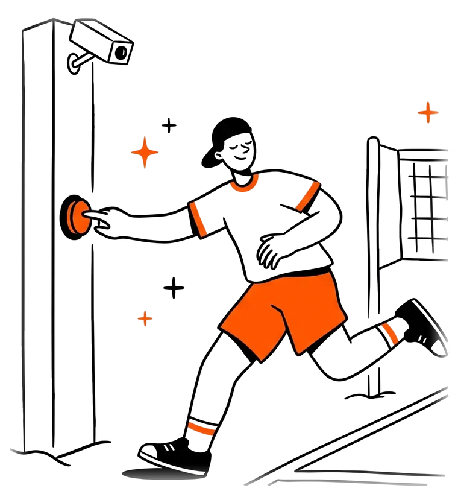 | `p-botao.webp` (760×824) | Hero, esquerda | Lucas aperta o botão na coluna, câmera gravando |
| 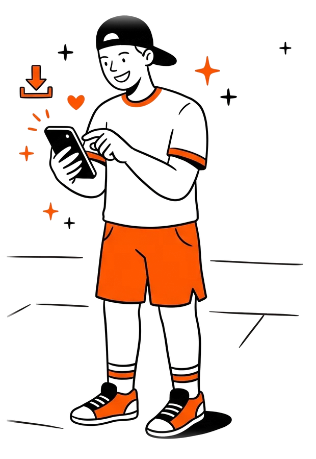 | `p-celular.webp` (620×899) | Hero, direita | Vendo e baixando o lance no celular |
| 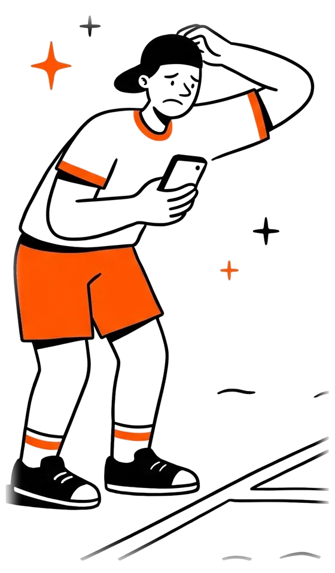 | `p-problema.webp` (560×957) | O problema | Procurando o lance no celular, sem achar |
| 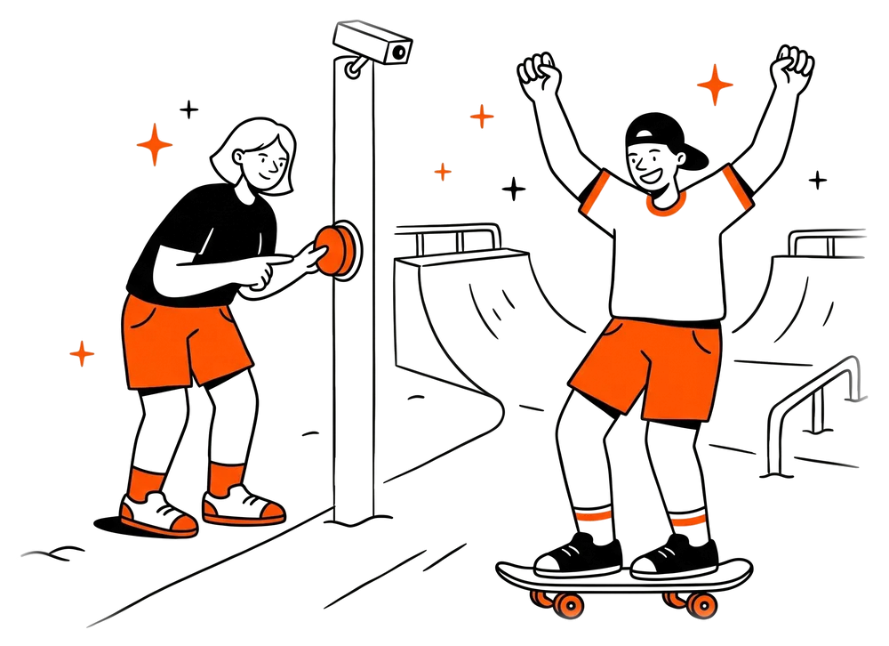 | `p-skate.webp` (1000×726) | Como funciona (carrossel) | Skatista comemora, a amiga aperta o botão |
| 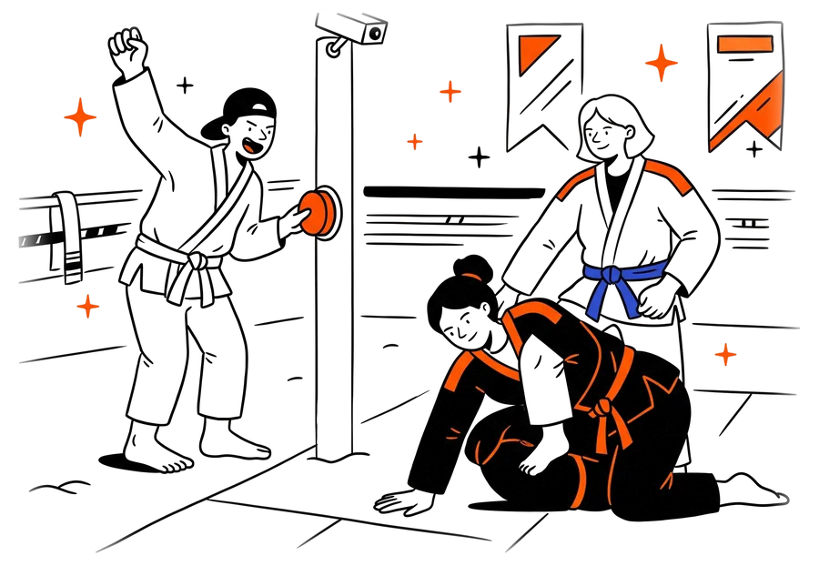 | `p-luta.webp` (1000×726) | Como funciona (carrossel) | Lutador comemora apertando o botão no tatame |
| 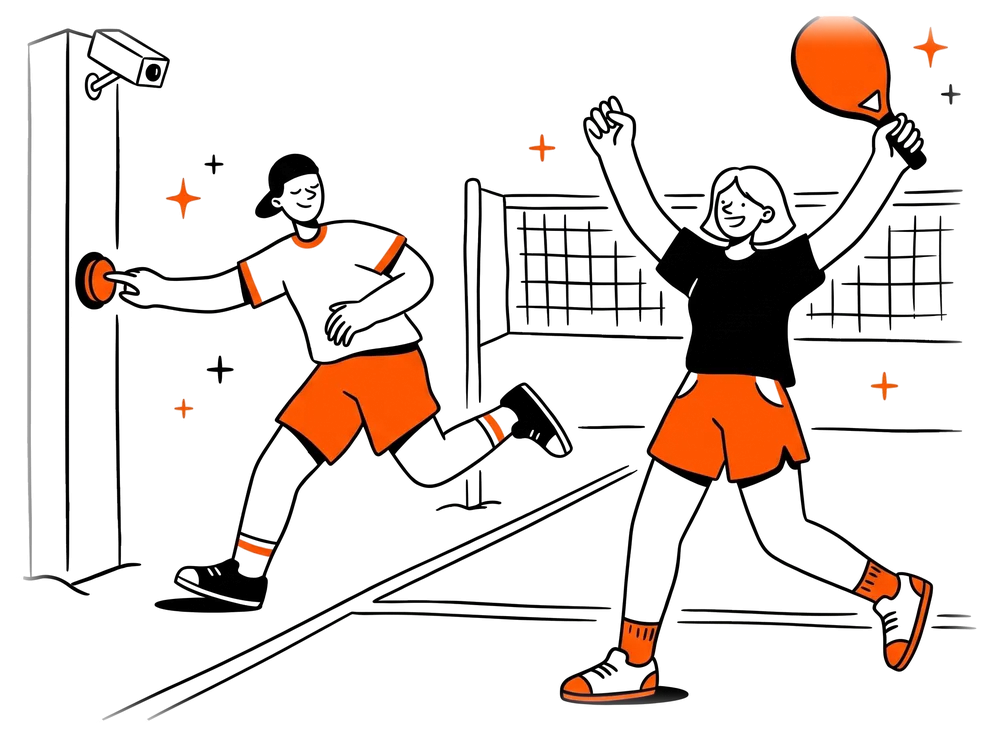 | `p-quadra.webp` (1000×726) | Como funciona (carrossel) | Lucas aperta o botão, Ana comemora o ponto |
| 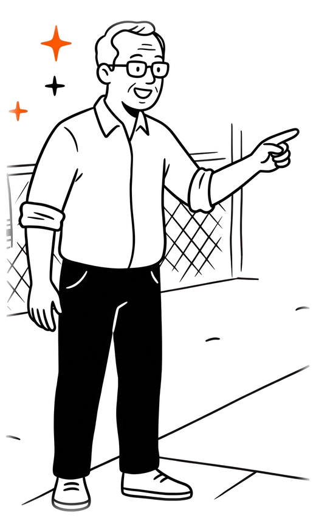 | `p-dono.webp` (520×869) | Calculadora de patrocínio | Seu João aponta para a receita |
| 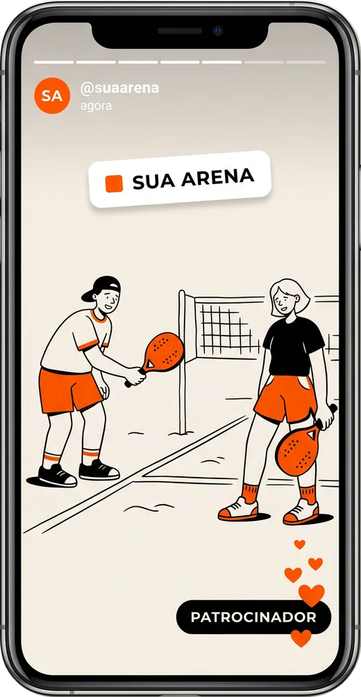 | `p-story.webp` (520×1001) | Sua marca em cada story | Celular com o story, selo "SUA ARENA" e "PATROCINADOR" |
| 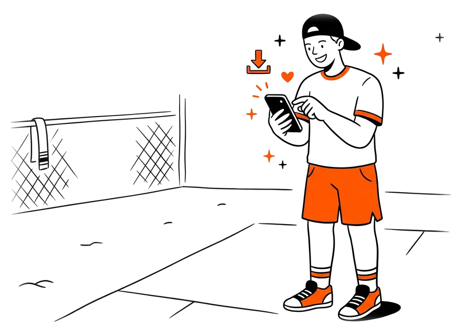 | `p-entrega.webp` (900×654) | O que a Aatlas entrega | Jogador na quadra baixando o replay |
| 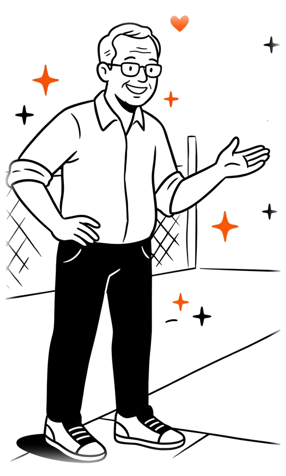 | `p-atende.webp` (560×931) | Dúvidas | Dono sorrindo, convidando para conversar |
| 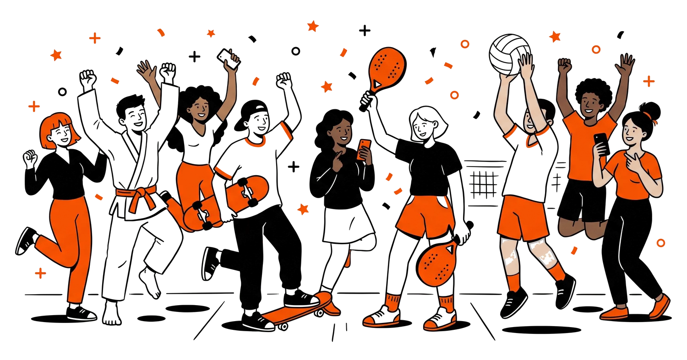 | `p-festa.webp` (1500×787) | CTA final | Jogadores de vários esportes comemorando |
| 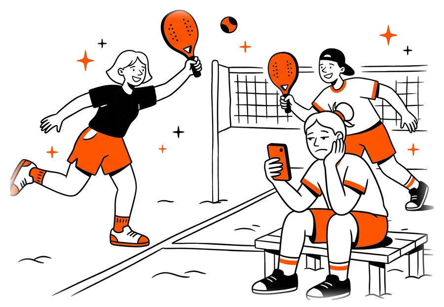 | `p-banco.webp` (900×623) | Indique uma arena | Jogadora triste no banco enquanto as amigas jogam |
| 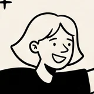 | `ana.webp` (40×40 na tela) | Balão do WhatsApp | Avatar redondo com borda laranja |

#### Regras do estilo

1. **Traço**: contorno preto grosso e levemente irregular, como caneta; cantos arredondados, sem hachura.
2. **Cor**: preenchimento chapado em só 3 cores — preto, branco e laranja da marca. Pele e fundo ficam sem cor (branco).
3. **Laranja onde há ação ou marca**: short, raquete, botão de replay, celular, listras de gola, meia e tênis.
4. **Sombra**: só uma elipse preta chapada sob os pés. Sem degradê, sem sombra no corpo.
5. **Cenário mínimo em linha**: rede, coluna, alambrado, linhas da quadra e tufos de areia, sem preenchimento.
6. **Brilhos**: estrelas de 4 pontas laranja e "+" pretos ao redor da ação (o mesmo "+" das ilustrações de produto); confetes na festa.
7. **Expressão**: olhos em arco ou pontos, sorriso aberto; tristeza só para mostrar o problema (sem vídeo).
8. **Produto sempre visível**: câmera na coluna, botão laranja ou celular aparecem na cena sempre que possível.
9. **Arquivo**: WebP com fundo transparente, `width` e `height` no HTML, `loading="lazy"` fora do hero e `alt` descrevendo a cena.
10. **Na página**: altura máxima de 300px no hero e no card do problema, alinhados por baixo; ilustração de produto ao lado dentro de `.art`.

Novo personagem ou cena: gerar sobre fundo claro no mesmo estilo, com o elenco acima, e recortar com `python personagens/recortar.py .` (precisa de `pillow` e `numpy`).

### Raios, bordas e sombras

| Token | Valor | Uso |
| --- | --- | --- |
| `--r-xl` | 32px | Painéis grandes, CTA, faixas, monitor do vídeo |
| `--r-lg` | 24px | Card padrão, páginas de texto |
| `--r-md` | 18px | Cards de lista, planos, FAQ |
| — | 12–14px | Quadrado de ícone, inputs, botões de plano |
| — | 999px | Botões, topbar, chips, pills |
| `--shadow` | 0 1px 2px /.05 + 0 20px 40px -24px /.26 | Todo card |
| `--shadow-lg` | 0 2px 6px /.05 + 0 44px 80px -44px /.38 | Painéis grandes e balão |

As sombras usam a cor da tinta (23,25,30), nunca preto puro.

### Movimento

| Efeito | Duração / curva | Onde |
| --- | --- | --- |
| Entrada ao rolar (`data-reveal`) | 780ms, sobe 26px, 80ms entre irmãos | Blocos e cards |
| Entrada com desfoque (`data-reveal="blur"`) | 500ms, desce 20px + blur 10px, 200ms entre irmãos | Destaques |
| Título cortado (`data-cut`) | 700ms por palavra, 120ms entre palavras | Título dos planos |
| Hover de botão | 0.2s, sobe 1px | `.btn`, `.pbtn` |
| Faixa de esportes | 42s linear, infinita | `.sports` |
| Carrossel de cenas | troca a cada 2s, arrastável | `.reel` |

Curva padrão: `cubic-bezier(.2,.75,.2,1)`. Tudo já está visível antes da animação; com `prefers-reduced-motion` todas as animações e transições são desligadas.

No desktop o cursor é uma seta laranja de aviãozinho de papel (SVG embutido em `--cur`).

## Acessibilidade e boas práticas

Todo texto do site passa no WCAG AA (4.5:1). A base foi pensada para um público pouco digital: letra grande, área de toque de 44px e foco visível.

| Par (texto / fundo) | Contraste | AA texto normal |
| --- | --- | --- |
| `--ink` / `--bg` | 16.0:1 | Passa |
| `--muted` / `--bg` | 6.4:1 | Passa |
| `--faint` / branco | 5.1:1 | Passa |
| Branco / `--accent-2` | 4.9:1 | Passa |
| `--accent-3` / `--bg` (eyebrow, valores e unidades) | 5.9:1 | Passa |
| `--accent-3` / `--accent-soft` | 5.6:1 | Passa |
| Branco / `--accent` | 3.8:1 | Não usar: texto branco nunca vai sobre `--accent` |
| Branco / WhatsApp #1DA851 | 3.1:1 | Só ícone (o `.fab` não tem texto) |

Contraste calculado pela fórmula WCAG 2.x sobre os hex do `:root`.

Regra de contraste do laranja: `--accent` só em texto grande (títulos em itálico), ícones e formas; texto laranja pequeno usa `--accent-3`; texto branco sobre laranja usa fundo `--accent-2`.

O que já está garantido:

- Foco: contorno laranja de 3px com 3px de afastamento em todo elemento (`:focus-visible`).
- `prefers-reduced-motion` desliga todo movimento; o conteúdo nunca depende de animação para aparecer.
- O vídeo não toca sozinho; só começa com som quando a pessoa clica.
- FAQ com `
` nativo, sliders com `<input type="range">` e `<output>`.

Faça:

- Usar os tokens do `:root`; criar token novo antes de repetir um hex.
- Manter um único card em destaque laranja por grupo.
- Testar em 360px, 720px e 1024px antes de publicar.
- Copiar mudanças de tokens, topbar e rodapé para `paginas.css`.
- Liberar na CSP do `vercel.json` qualquer fonte, script ou pixel novo de terceiros.

Não faça:

- Desenhar ícones à mão ou carregar de CDN.
- Criar modo escuro ou fundos coloridos além de `--accent-2` e `--accent-soft`.
- Usar laranja em texto corrido ou `--faint` em informação importante.
- Usar Instrument Serif fora da frase de efeito em itálico.
- Trocar um arquivo em `assets/` sem mudar o nome (o cache é de 7 dias).
